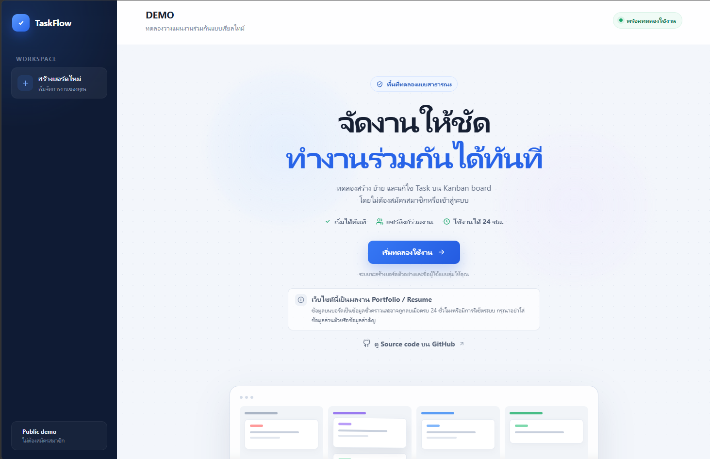
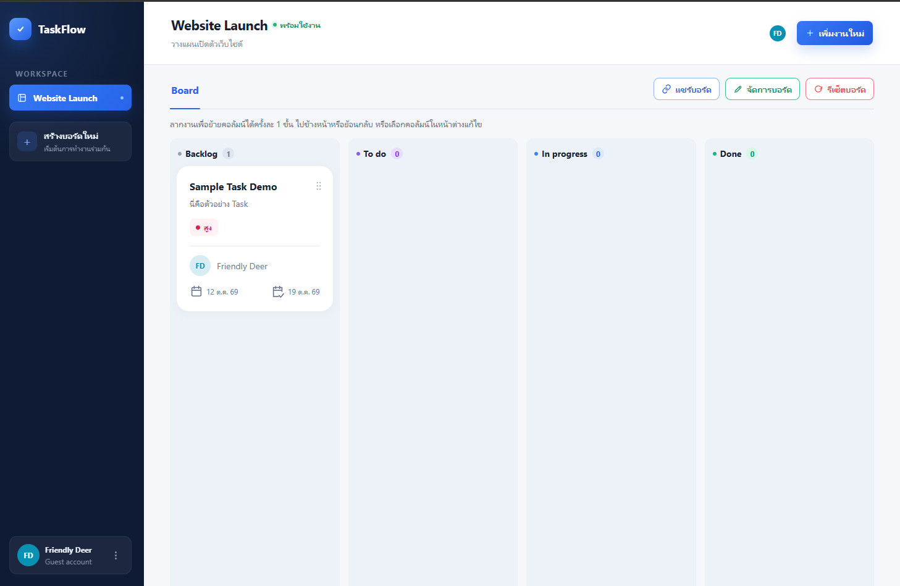
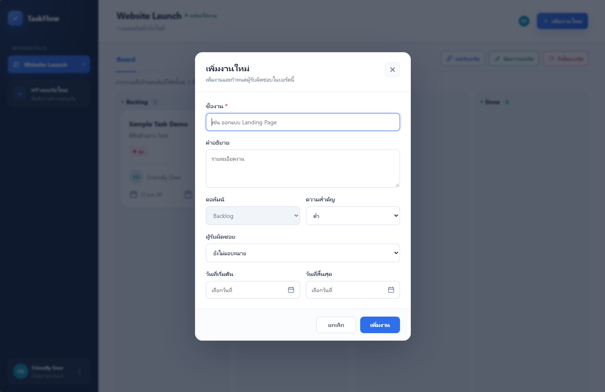

# TaskFlow — Real-time Collaborative Task Manager

A portfolio project built with ASP.NET Core MVC and SignalR. TaskFlow lets
visitors share a Kanban board and manage tasks together without registration,
while protecting saved work from stale concurrent edits.

> **Portfolio demo:** guest identities and board data are temporary. Guest
> sessions last 24 hours; boards expire with their creator's guest session.
> Expired data is cleaned up automatically. Do not enter personal, confidential
> or business-critical information. This is not a production task-management service.

## Screenshots

### Landing page

Start a demo without registration, with a clear notice about temporary data.



### Kanban board

Organize tasks across Backlog, To do, In progress and Done, with priority,
assignee and Thai dates on each card. Board actions include sharing and owner controls.



### Create a task

Add a task with a description, priority, assignee and optional dates.
New tasks start in Backlog with Low priority.



## Features

- **Anonymous guests:** randomly generated names and avatar colors, with no login.
- **Shareable boards:** a public link joins the same board; joining never creates
  a replacement board or grants ownership.
- **Task management:** create, edit, delete, assign priority/responsibility and
  set optional start/due dates. New tasks start in Backlog with Low priority.
- **Validated drag and drop:** tasks move one adjacent column at a time, both
  through dragging and the edit form.
- **Real-time collaboration:** changes appear in other connected browsers;
  open forms retain their drafts and original concurrency tokens.
- **Live presence:** online avatars are deduplicated across tabs, with four
  avatars plus `+N`; colored task borders indicate current editors without locking tasks.
- **Owner controls:** only the owner can rename or reset a board. Reset removes
  tasks but keeps the board, columns and participants, without reseeding.
- **Thai date display:** full/short Buddhist Era dates in the UI, with Gregorian
  values retained for storage and form submissions.

## Tech Stack

| Area | Technology |
| --- | --- |
| Backend | C#, .NET 10, ASP.NET Core MVC |
| Persistence | Entity Framework Core 10, SQL Server |
| Real-time | ASP.NET Core SignalR |
| Frontend | Razor views, vanilla JavaScript, CSS |
| Background work | ASP.NET Core hosted services |
| Packaging | Multi-stage Linux Dockerfile |

## Architecture

The solution separates business rules, application workflows, persistence and
HTTP/UI concerns into four layers:

```text
src/
├── TaskManager.Domain/          Entities, enums and date/presentation helpers
├── TaskManager.Application/     Services, interfaces and request/response models
├── TaskManager.Infrastructure/  EF Core, repositories, migrations and cleanup
└── TaskManager.WebUI/           MVC, Razor, cookies, SignalR and hosted services
```

The Domain layer has no dependency on infrastructure. Application workflows
depend on interfaces; Infrastructure supplies persistence implementations, and
WebUI composes the application through dependency injection.

The main entities are anonymous users, boards, participants, columns and tasks.
See the [ER diagram](documents/er-diagram.md) and
[technical notes](documents/technical-notes.md) for implementation details.

## Quick Start

### Prerequisites

- .NET 10 SDK.
- SQL Server Express running as `.\SQLEXPRESS`, or another reachable SQL Server
  instance with an appropriately configured connection string.
- EF Core CLI **10.0.12**, matching the current EF packages.
- Node.js to run the JavaScript checks. No npm packages are required.
- Docker is optional for building the application image.

The steps below target local development on Windows with SQL Server Express.

### 1. Clone and restore

```powershell
git clone https://github.com/Issarat/task-managements.git
cd task-managements
dotnet restore TaskManager.slnx
```

If the EF CLI is not installed:

```powershell
dotnet tool install --global dotnet-ef --version 10.0.12
```

If it is already installed, check `dotnet ef --version` and use
`dotnet tool update --global dotnet-ef --version 10.0.12` if needed.

### 2. Configure the development database

The supplied `src/TaskManager.WebUI/appsettings.Development.json` uses:

```json
{
  "ConnectionStrings": {
    "DefaultConnection": "Server=.\\SQLEXPRESS;Database=TaskManager;Trusted_Connection=True;MultipleActiveResultSets=True;TrustServerCertificate=True"
  }
}
```

Ensure that SQL Server is running and your Windows account can create/use the
development database. Change the connection string for a different instance.
Keep credentials out of Git; use .NET user secrets in development or the
`ConnectionStrings__DefaultConnection` environment variable when deploying.

### 3. Apply migrations

From the repository root:

```powershell
dotnet ef database update --project src/TaskManager.Infrastructure --startup-project src/TaskManager.WebUI -- --environment Development
```

This applies the existing migrations to the configured database. The application
does **not** automatically apply migrations on startup; select a development
database before running this command. See the [EF CLI reference](https://learn.microsoft.com/en-us/ef/core/cli/dotnet).

### 4. Start the HTTPS application

```powershell
dotnet dev-certs https --trust
dotnet run --project src/TaskManager.WebUI --launch-profile https
```

Trusting the development certificate may require confirmation. See the
[HTTPS certificate reference](https://learn.microsoft.com/en-us/dotnet/core/tools/dotnet-dev-certs).
Open [https://localhost:7168](https://localhost:7168), then press the trial button
on the landing page. A new trial board includes sample data; ordinary board
creation and Reset do not automatically insert sample tasks.

## Testing

Run these commands from the repository root:

```powershell
node tests/board-realtime.checks.cjs
node tests/thai-date.checks.cjs
dotnet run --project tests/TaskManager.Realtime.Checks -c Release
```

These checks cover browser-script behavior, date formatting, real local
HTTP/WebSocket interactions, validation, owner permissions, presence, reconnects
and draft preservation. The .NET test host uses fake application data and does
not connect to the application's database.

SQL Server concurrency checks are a separate, explicit opt-in:

```powershell
dotnet run --project tests/TaskManager.Concurrency.Checks -c Release -- --sql-local
```

**Database safety:** this runner uses Windows integrated authentication on
`.\SQLEXPRESS`, creates a unique `TaskManager_RowVersionChecks_<random>` database,
and deletes that exact database in `finally`. It never uses the application's
connection string or its `TaskManager` database. The SQL account needs
create/drop-database permissions. Checks cover simultaneous joins, independent
and same-task edits, stale writes, append ordering and atomic Reset.

For a manual check, open one public board URL in two different browsers. Add,
edit or move a task, verify the other browser updates, then keep an edit dialog
open while another guest changes the task and confirm the draft is retained.

### Docker smoke test (Windows)

With Docker Desktop running Linux containers, PowerShell 7 and a trusted
localhost development certificate, run from the repository root:

```powershell
docker build -f src/TaskManager.WebUI/Dockerfile -t taskflow:local .
pwsh -File tests/docker-smoke.ps1
pwsh -File tests/docker-smoke.ps1 -RenderProxy
```

This starts the production image on a temporary loopback HTTPS port and checks
the landing page, static assets, Thai date formatting, SignalR negotiation,
an actual WebSocket handshake and rejection of unauthenticated board joins.
The exported certificate is mounted read-only, not copied into the image.
The test stops its container and removes its temporary certificate afterwards.

**Scope:** no database is connected and expiry cleanup is disabled. This does
not test guest creation, task CRUD or synchronization between board members.
Those require a reachable SQL Server database and applied migrations; the
Windows integrated-authentication development connection string cannot be
used unchanged inside the Linux container.

## Deployment

Deployment preparation targets a Free Docker Web Service on Render and a separate
SQL Server database on MonsterASP.NET. See the [step-by-step deployment guide](documents/deploy-render.md)
and `render.yaml`. Apply migrations before deployment and keep the real connection
string in Render environment variables, never in Git. The cloud connection and
redeploy/key persistence still need verification against the actual services.

## Design Decisions

- **Optimistic concurrency:** SQL Server `rowversion` rejects stale task writes.
  Independent tasks can save without conflicting over a previously loaded
  board version. Reset checks the owner's submitted board version before deletion.
- **Advisory editing presence:** an editor outline communicates who is working;
  it is not a mutex. Persistence checks remain the authority for concurrent saves.
- **Server-rendered snapshots:** SignalR invalidates display data; the browser
  fetches authenticated Razor markup rather than duplicating task rendering logic.
- **Temporary identities:** random tokens stay in `HttpOnly`, `Secure`,
  `SameSite=Lax` cookies; only their SHA-256 hashes are stored in the database.
- **Expiry-based cleanup:** startup/periodic batches remove expired data, not all
  boards at midnight. Expired guests referenced by surviving boards are retained
  until their memberships can safely be removed.
- **One date-format source:** `DatetimeExtensions` owns Thai and ISO formats.
  Timestamps remain UTC; calendar-only task dates are never timezone-shifted.

## Limitations

- Public links grant task-editing access to their holders. There is no account
  system, enterprise role model or permanent storage guarantee.
- Online/editing presence is in memory and supports **one application instance**.
  Scaling out requires shared presence and SignalR group/message distribution.
- Network disconnects become visible when SignalR detects them, not necessarily
  the moment a browser loses connectivity. Mobile layouts hide header avatars.
- Any task activity changes the board's row version. An open owner edit/Reset
  confirmation can therefore require reloading and reviewing the latest data.
- Task descriptions store Markdown source, but a rendered/sanitized GitHub-style
  Markdown preview is not implemented. Cards show a short plain-text preview.
- The Dockerfile packages WebUI only: an external SQL Server database and applied
  migrations are required. Render proxy handling and SQL-backed Data Protection
  keys are opt-in deployment settings; see the deployment guide for their security limits.

## Roadmap

- [ ] Complete the first Render deployment and verify the external SQL connection
  and Data Protection key persistence across redeploys.
- [ ] Fix drag/drop pending-state restoration after browser Back/Forward cache navigation.
- [ ] Add request throttling and demo data quotas before wider public exposure.
- [ ] Add CI automation for the regression checks.
- [ ] Add a safe Markdown preview for task descriptions.

For cleanup options, reconnect behavior and detailed regression scenarios,
continue with the [technical notes](documents/technical-notes.md).
