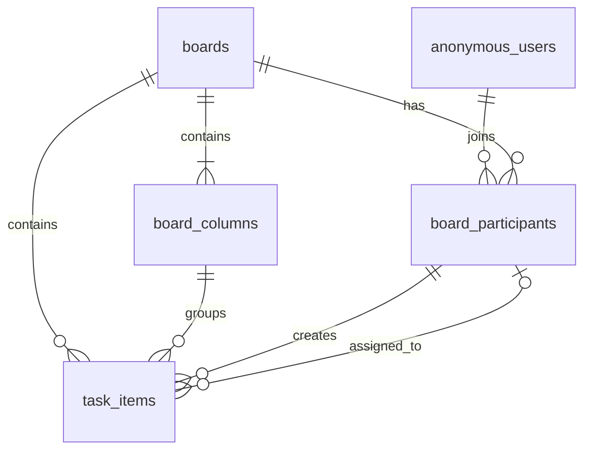

# Collaborative Task Manager — ER Diagram

> Status: Schema and behavior implemented by the current public web-demo application.
>
> Database: SQL Server / Azure SQL. The application has no registration or login. Visitors receive short-lived anonymous identities and board-owner tokens through secure cookies.

## Date and time policy

- Store application timestamps as UTC in `datetime2`; do not store a `+07:00` offset and do not use `datetimeoffset`.
- Use `SYSUTCDATETIME()` for database-generated timestamps and `DateTime.UtcNow` in the application.
- Values in the database use the Gregorian calendar (A.D. / C.E.), not the Buddhist Era calendar.
- Convert UTC to `Asia/Bangkok` only when displaying a value in the UI.
- `start_date` and `due_date` are calendar dates without a time or timezone, so they use SQL Server `date`.
- A newly generated guest expires 24 hours after creation. A board inherits its creator's existing guest expiry (so it may have less than 24 hours remaining). Joining or editing does not extend these UTC `expires_at_utc` values; there is no global midnight reset.

## Diagram

---

## Table definitions

### `anonymous_users`

Stores the temporary identity generated for a visitor. The raw session token is kept in an `HttpOnly`, `Secure`, `SameSite=Lax` cookie; the database stores its SHA-256 hash. The application does not additionally encrypt the token's cookie value.

| Column | Type | Key | Nullable | Default | Description |
| --- | --- | --- | --- | --- | --- |
| `anonymous_user_id` | `uniqueidentifier` | PK | No | Application generated | Unique identifier of the anonymous visitor |
| `session_token_hash` | `char(64)` | UK | No | — | SHA-256 hash of the random session token |
| `display_name` | `nvarchar(80)` | — | No | — | Generated display name, for example `Clever Fox` |
| `avatar_color` | `char(7)` | — | No | — | Generated hexadecimal avatar color, for example `#7C3AED` |
| `created_at_utc` | `datetime2` | — | No | `SYSUTCDATETIME()` | UTC creation time in the Gregorian calendar |
| `last_seen_at_utc` | `datetime2` | — | No | `SYSUTCDATETIME()` | UTC time of the visitor's latest activity |
| `expires_at_utc` | `datetime2` | — | No | — | UTC creation time plus 24 hours |
| `row_version` | `rowversion` | — | No | Auto | Optimistic concurrency token |

The anonymous identity cookie uses `HttpOnly`, `Secure`, and `SameSite=Lax`. Its expiry matches `expires_at_utc`.

---

### `boards`

Stores public demo boards. Anyone with the public URL can open and edit tasks. Destructive board-level actions additionally require the owner token.

| Column | Type | Key | Nullable | Default | Description |
| --- | --- | --- | --- | --- | --- |
| `board_id` | `uniqueidentifier` | PK | No | Application generated | Internal identifier of the board |
| `public_id` | `varchar(32)` | UK | No | Application generated | Cryptographically random Base64URL identifier used in `/boards/{publicId}` |
| `name` | `nvarchar(120)` | — | No | — | Display name of the board |
| `description` | `nvarchar(500)` | — | Yes | `NULL` | Short board description |
| `owner_token_hash` | `char(64)` | UK | No | — | SHA-256 hash of the owner token; the raw token exists only in the owner's cookie |
| `created_at_utc` | `datetime2` | — | No | `SYSUTCDATETIME()` | UTC creation time in the Gregorian calendar |
| `updated_at_utc` | `datetime2` | — | Yes | `NULL` | UTC time of the latest board metadata or task update |
| `last_activity_at_utc` | `datetime2` | — | No | `SYSUTCDATETIME()` | UTC time of the latest board or task activity |
| `expires_at_utc` | `datetime2` | — | No | — | Expiry inherited from the creator's guest session |
| `row_version` | `rowversion` | — | No | Auto | Optimistic concurrency token |

Owner-cookie names include the board public ID (`taskflow_board_owner_{publicId}`), with cookie Path `/`. Sharing the public URL never shares the owner token. Both board metadata changes and Reset require a matching owner token.

---

### `board_participants`

Stores anonymous visitors who have opened a board. It supplies the assignee list and preserves the identity shown on existing tasks.

| Column | Type | Key | Nullable | Default | Description |
| --- | --- | --- | --- | --- | --- |
| `board_participant_id` | `uniqueidentifier` | PK | No | Application generated | Unique identifier of the board participant |
| `board_id` | `uniqueidentifier` | FK → `boards.board_id` | No | — | Board opened by the visitor |
| `anonymous_user_id` | `uniqueidentifier` | FK → `anonymous_users.anonymous_user_id` | No | — | Anonymous visitor identity |
| `joined_at_utc` | `datetime2` | — | No | `SYSUTCDATETIME()` | UTC time when the visitor first opened the board |
| `last_seen_at_utc` | `datetime2` | — | No | `SYSUTCDATETIME()` | UTC time of the visitor's latest activity on this board |
| `row_version` | `rowversion` | — | No | Auto | Optimistic concurrency token |

Owner authorization must be based on the owner token, not on a client-supplied participant ID.

---

### `board_columns`

Stores ordered Kanban columns. A trial board starts with `Backlog`, `To do`, `In progress`, and `Done`.

| Column | Type | Key | Nullable | Default | Description |
| --- | --- | --- | --- | --- | --- |
| `board_column_id` | `uniqueidentifier` | PK | No | Application generated | Unique identifier of the column |
| `board_id` | `uniqueidentifier` | FK → `boards.board_id` | No | — | Board containing the column |
| `name` | `nvarchar(80)` | — | No | — | Display name of the column |
| `column_key` | `varchar(40)` | — | No | — | Stable key such as `backlog`, `todo`, `in-progress`, or `done` |
| `sort_order` | `int` | — | No | `0` | Display order within the board |
| `created_at_utc` | `datetime2` | — | No | `SYSUTCDATETIME()` | UTC creation time in the Gregorian calendar |
| `updated_at_utc` | `datetime2` | — | Yes | `NULL` | UTC time of the latest rename or reorder |
| `row_version` | `rowversion` | — | No | Auto | Optimistic concurrency token |

Initial columns use sort orders `1`, `2`, `3`, and `4`.

---

### `task_items`

Stores tasks and their current Kanban positions. Task deletion is a physical delete because all data belongs to a short-lived public demo cycle.

| Column | Type | Key | Nullable | Default | Description |
| --- | --- | --- | --- | --- | --- |
| `task_item_id` | `uniqueidentifier` | PK | No | Application generated | Unique identifier of the task |
| `board_id` | `uniqueidentifier` | FK → `boards.board_id` | No | — | Board containing the task |
| `board_column_id` | `uniqueidentifier` | Composite FK → `board_columns` | No | — | Current Kanban column |
| `title` | `nvarchar(60)` | — | No | — | Task title; matches the 60-character UI limit |
| `description_markdown` | `nvarchar(max)` | — | Yes | `NULL` | GitHub-style Markdown source; application limit is 20,000 characters |
| `priority` | `varchar(20)` | — | No | `'Medium'` | Task priority: `Low`, `Medium`, or `High` |
| `sort_order` | `decimal(18,6)` | — | No | `0` | Position within the column |
| `assigned_to_participant_id` | `uniqueidentifier` | Composite FK → `board_participants` | Yes | `NULL` | Anonymous participant assigned to the task |
| `start_date` | `date` | — | Yes | `NULL` | Optional Gregorian calendar start date |
| `due_date` | `date` | — | Yes | `NULL` | Optional Gregorian calendar due date |
| `created_by_participant_id` | `uniqueidentifier` | Composite FK → `board_participants` | No | — | Anonymous participant who created the task |
| `created_at_utc` | `datetime2` | — | No | `SYSUTCDATETIME()` | UTC creation time in the Gregorian calendar |
| `updated_at_utc` | `datetime2` | — | Yes | `NULL` | UTC time of the latest update |
| `row_version` | `rowversion` | — | No | Auto | Optimistic concurrency token returned to clients |

Only Markdown source is stored; rich Markdown rendering/sanitization is not implemented. Task details use a text editor. Cards receive the first nonempty line, trimmed and truncated to at most 90 characters, displayed as HTML-encoded text. The database/domain priority default remains `Medium`; the new-task UI defaults to `Low`.

---

## Constraints and indexes

### `anonymous_users`

- Unique index on `session_token_hash`.
- Index on `expires_at_utc` for periodic expired-data cleanup.
- `avatar_color` must be generated by the server from the approved palette.

### `boards`

- Unique index on `public_id`.
- Unique index on `owner_token_hash`.
- Index on `expires_at_utc` for periodic expired-data cleanup.
- Check constraint: `last_activity_at_utc >= created_at_utc`.
- Check constraint: `expires_at_utc > created_at_utc`.
- A board is available only when `expires_at_utc > SYSUTCDATETIME()`.

### `board_participants`

- Unique constraint on `(board_id, anonymous_user_id)`.
- Unique constraint on `(board_participant_id, board_id)` to support composite task foreign keys.
- Index on `(board_id, last_seen_at_utc)`.

### `board_columns`

- Unique constraint on `(board_id, column_key)`.
- Unique constraint on `(board_column_id, board_id)` to support the composite task foreign key.
- Index on `(board_id, sort_order)`; `sort_order` is intentionally not unique.

### `task_items`

- Composite foreign key `(board_column_id, board_id)` → `board_columns(board_column_id, board_id)` prevents cross-board column assignment.
- Composite foreign key `(created_by_participant_id, board_id)` → `board_participants(board_participant_id, board_id)` prevents cross-board creator assignment.
- Composite foreign key `(assigned_to_participant_id, board_id)` → `board_participants(board_participant_id, board_id)` prevents cross-board assignee assignment.
- Index on `(board_id, board_column_id, sort_order)`.
- Index on `(board_id, assigned_to_participant_id)`.
- Check constraint: `priority IN ('Low', 'Medium', 'High')`.
- Check constraint: `sort_order >= 0`.
- Check constraint: `start_date IS NULL OR due_date IS NULL OR start_date <= due_date`.

---

## Demo lifecycle rules

### Start trial

`HomeController.TryDemo` runs after the visitor presses the trial button. It reuses a valid guest or creates one, then opens that guest's most recently active live board if one exists. Otherwise, `BoardService.CreateAsync` creates a trial board with its owner-token hash, creator membership, four columns and one sample task. The board aggregate is saved atomically; guest creation is a separate save, not part of that transaction.

Ordinary **Create board** does not include sample tasks. Opening a shared link enrolls the visitor in that existing board, without creating/reseeding a replacement board. Sample data is generated at runtime, not through EF Core `HasData`.

### Manual reset

- **Reset board** is owner-only.
- It physically deletes all `task_items` for the board in one transaction.
- It keeps the board, participants, and four columns.
- It leaves the board empty and does not automatically insert sample tasks.

There is no **Load sample data** action in the current UI.

### Expired-data cleanup

- Guest and board expiry is enforced on access independently of physical deletion.
- A hosted service runs cleanup on startup and every five minutes by default, deleting at most 100 expired boards and 100 expired guests per batch.
- Each batch is transactional. Tasks are deleted before their participant/column dependencies, then the expired boards are removed.
- Expired guests are deleted only when they have no board memberships. A surviving board retains referenced authors/assignees.
- Cleanup never resets valid boards or seeds replacement data. If the host stops or sleeps, cleanup resumes when the application runs again.
- An expired public URL does not reopen/recreate that board. A visitor without a valid guest receives the landing-page unavailable flow; an existing guest can receive a not-found response.

---

## Real-time presence

Task presence is transient and is not stored in a database table.

- SignalR presence tracks each live connection's guest profile, board, edited task and session/board expiry in server memory. Persistent board memberships are separate from online presence.
- A task being used by another participant receives an outline matching that participant's avatar color.
- Cards expose editor names through tooltips and accessible descriptions. Multiple tabs for the same guest are deduplicated, and multiple guests can edit simultaneously.
- Modal close clears that connection's editing state; disconnection clears its online state. Network failures are reflected when SignalR detects the disconnect, not by a custom 15-second heartbeat rule.
- A worker removes expired board/guest connections on a five-second interval while the application is running.
- Current events are `BoardChanged`, `BoardPresenceChanged` (including editors), and `BoardSessionExpired`.

## Delete behavior

- Deleting a board cascades to `board_columns`, `board_participants`, and `task_items`.
- Deleting an anonymous user is restricted while participant rows still reference it; periodic cleanup removes expired boards first.
- Deleting a board participant is restricted while tasks still reference it.
- Task deletes are physical deletes and are broadcast through SignalR.

